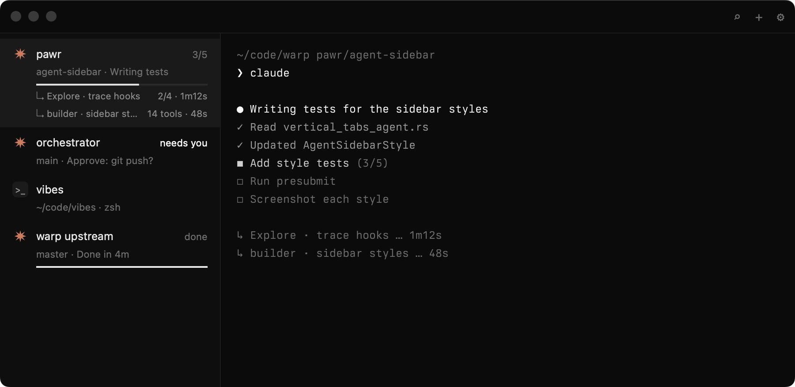

# Haunt

A quiet macOS terminal for running many coding agents side by side: Claude Code, Codex and more.



Every tab is a real terminal (libghostty). The sidebar shows what each agent is doing, built from Claude Code's own hook events, never from guessing at screen output:

- **Grouped by state:** Needs you, Running, Idle.
- **Real progress:** task counts and a progress bar, plus one row per subagent with its tool count and elapsed time.
- **The pending prompt:** "Approve: git push?" shows on the row, so you can see which tab is waiting without opening it.
- **Plain shells:** shell tabs sit alongside agents, showing their folder and shell.

The design is black and white with one accent: the Claude orange.

> Status: early. Phase 1 (tabs, sidebar, live agent state) works. Phase 2 (notifications with Allow/Deny, ⌘K palette, plugins) is in progress. macOS 15+ on Apple silicon.

## How it works

```
Claude Code ──hooks──▶ ~/.haunt/sock ──▶ haunt-core (Rust) ──UniFFI──▶ Swift / AppKit UI
                                             │                          └─ libghostty surfaces
                                             └─ WASM plugins (wasmtime)
```

- **Agent adapters** live in their own repos and all follow one agent-neutral event spec. The Claude Code adapter, [haunt-claude](../haunt-plugins/haunt-claude), is a Claude Code plugin. It sends session, task, subagent, tool and permission events as JSON lines to a private Unix socket.
  - Each tab gets its own surface id and a random nonce in its environment.
  - Events without the right nonce only update status. They can never create a permission request.
- **`core/`** holds the agent model, sidebar layout, decision log, allowlist suggestions and plugin host. It has no UI code, so future Windows and Linux front ends can share it.
- **`macos/`** is the native app: title bar, sidebar, tabs and libghostty surfaces.
- **`wit/`** defines the plugin API (`haunt:plugin@0.3`).
  - Plugins are sandboxed WASM components. Each capability is granted when you install the plugin and pinned in a lockfile.
  - A plugin gets no filesystem, network or environment it wasn't granted.

Design tokens live in `design/tokens.json`. `design/check` compares the running app against the reference mockups pixel by pixel.

## Build

Requires Xcode 16.3+ and Rust (pinned in `rust-toolchain.toml`). libghostty is prebuilt in `macos/deps/`. Only `scripts/update-ghostty.sh` needs Zig, when bumping Ghostty.

```sh
macos/build.sh && macos/make-app.sh     # builds core, bindings and build/haunt.app
open build/haunt.app
```

`make-app.sh` needs the Claude adapter checked out (see below). It also bundles the Codex adapter if `../haunt-plugins/haunt-codex` is there (or `HAUNT_CODEX_ADAPTER`), the `haunt` CLI as `haunt.app/Contents/Helpers/haunt`, and the first-party decision-log and allowlist plugins from `../haunt-plugins/` (built for `wasm32-wasip2`; Haunt installs them on launch, see `docs/core-api.md`).

Signing: set `HAUNT_SIGN_ID`, or put your identity in a `.sign-id` file (gitignored). Without either, the app is signed ad hoc.

## Set up

```sh
haunt setup                  # asks: Claude Code, Codex, both, or just the terminal
haunt setup claude|codex     # set up one
haunt setup --remove codex   # take one out
```

Each run first prints the exact change and asks before making it: the `claude plugin` commands for Claude Code, a diff of `~/.codex/config.toml` for Codex. `--dry-run` changes no agent config (it only stages the adapter copy below); `--yes` skips the question. The choice is kept in `~/.haunt/state.json` (`$HAUNT_CONFIG_DIR`, else `$HAUNT_HOME`, when set). `--dry-run` ends with `preview sha256 <hex>`; `--expect <hex>` applies only if the change still matches that preview. On first launch the app asks the same question in a sheet and runs the same command; change it later in Settings (⌘,).

The adapter is first copied to `~/.haunt/adapters/<agent>/<content hash>` and installed from there, so moving or rebuilding haunt.app doesn't break it. Removing an agent deletes that copy. Run Haunt from `/Applications`: setup refuses a quarantined, translocated copy of the app.

For Claude Code it runs:

```sh
claude plugin marketplace add ~/.haunt/adapters/claude/<hash>
claude plugin install haunt@haunt
```

For Codex it runs the adapter's own `install.sh`, which adds a marked block of hooks to `$CODEX_HOME/config.toml` and backs the file up first; then trust the hooks with `/hooks` in Codex. See [haunt-codex](../haunt-plugins/haunt-codex).

The Claude adapter is the haunt-claude repo, cloned next to this one as `../haunt-plugins/haunt-claude`. `make-app.sh` also bundles a copy into `haunt.app/Contents/Resources/adapters/claude` (and haunt-codex into `adapters/codex`): the commit `macos/adapters.lock` pins, taken with `git archive`. It refuses a checkout with uncommitted changes or at another commit; bump the pin after pushing the adapter, or set `HAUNT_ADAPTER_UNPINNED=1` to bundle the working tree while iterating. Set `HAUNT_CLAUDE_ADAPTER` to use a checkout somewhere else. Or try it without installing: `claude --plugin-dir ../haunt-plugins/haunt-claude`. Needs `jq` 1.6+ and `nc`, both on macOS by default.

Optional: `shell/install.sh` installs a matching Claude Code theme and prints the zsh lines for a minimal prompt inside Haunt. It never edits your `~/.zshrc`.

## Configure

`~/.haunt/config.toml` is reloaded live:

```toml
font = "Berkeley Mono Variable"
font_size = 11

[layout]
agents_view = "narrow-list"                           # the default, and the only view so far
titlebar_buttons = ["search", "new_tab", "sidebar"]   # the default

[ghostty]            # passed through to libghostty, less the keys below
cursor-style = "bar"
```

`agents_view` is the view ⌘⇧A shows. `titlebar_buttons` lists the title bar's icons, left to right, from `search`, `new_tab`, `settings` and `sidebar`. Unknown names are skipped and logged; `[]` leaves the bar empty. Each icon's tooltip shows its shortcut from `[keys]`.

`[keys]` sets shortcuts by action name (the generated `config.toml` lists them with their defaults). A plugin's palette command is named `"<plugin id>/<item id>"`, for example `"dev.haunt.tabs/move-up" = "alt+cmd+up"`; a plugin's default key must include cmd and never takes one of Haunt's or a chord the terminal or macOS uses (a chord set here has no such limit), and bound plugin commands appear in the Window menu.

`[ghostty]` is passed through to libghostty, except for what would get a paste past Haunt's paste check or slip in config Haunt never sees. These are dropped and logged: `right-click-action = paste` or `copy-or-paste`, `middle-click-action = clipboard-paste`, any `keybind` to `paste_from_clipboard` or `paste_from_selection`, `config-file`, `config-default-files`, and any key or value with a line break. Haunt also always unbinds Ghostty's ⌘V, ⇧⌘V and Paste key, so every paste goes through its own Edit menu.

## Use

- **Tabs:** ⌘T new, ⌘W close, ⌘1–⌘9 select, ⇧⌘] and ⇧⌘[ next and previous. **Rename Tab** is in the Window menu (no default key; set `rename_tab` in `[keys]`), on a row's right-click menu, or a double-click on its name. An empty name goes back to the automatic one.
- **Agents view:** ⌘⇧A shrinks the window to a narrow strip of agent rows docked to the right of the screen, with shell tabs counted at the foot. Click a row to get the full window back on that tab, or press ⌘⇧A again. It is remembered across launches.
- **Paste:** ⌘V pastes the clipboard and ⇧⌘V (Edit ▸ Paste Selection, `paste_selection`) the selection. Haunt shows a paste that carries an escape, another control or a hidden character in full, characters spelled out, and asks first; Ghostty's own paste protection asks before a multi-line one that isn't bracketed.

## CLI

The CLI is bundled in the app. To put it on your PATH:

```sh
ln -s /Applications/haunt.app/Contents/Helpers/haunt /usr/local/bin/haunt   # or any folder on PATH, e.g. ~/.local/bin
```

```sh
haunt dump                       # sidebar state as JSON
haunt decisions [query]          # permission decision log
haunt plugin install ./my-plugin # shows the capabilities, asks before installing
haunt plugin list | remove <id> | approve <id>
haunt setup [claude|codex|none] [--remove] [--yes] [--dry-run] [--expect <sha256>]
```

## Plugins

Each plugin lives in its own repo. `haunt plugin new my-plugin [--dir <path>] [--id <reverse-dns id>]` scaffolds one from the built-in template (a minimal plugin that adds a ⌘K palette item, with the WIT this haunt implements) and runs `git init`. Build it with `cargo build --release --target wasm32-wasip2`, then run `haunt plugin install .`. The scaffold's README lists the capabilities and how to update the WIT pin. See `docs/core-api.md` for the host API and limits: 50 ms CPU per call, 64 MB memory, 10 MB storage.

## Tests

```sh
cargo test --workspace                   # the adapter e2e tests skip if an adapter or jq is missing
HAUNT_REQUIRE_ADAPTERS=1 cargo test --workspace   # ...and fail instead
../haunt-plugins/haunt-claude/tests/run.sh
../haunt-plugins/haunt-codex/tests/run.sh
macos/tests/keys.sh      # [keys], [layout], the generated Ghostty config and its refusals
macos/tests/paste.sh     # the paste preview and what needs confirming
macos/tests/sidebar.sh   # sidebar drop targets, the agents view's restored frame
macos/tests/loginpath.sh # the login-shell PATH lookup
macos/fidelity.sh        # pixel check against the mockups (HAUNT_INACTIVE=1 for the unfocused window)
```

## Licence

MIT. Haunt embeds libghostty from [Ghostty](https://github.com/ghostty-org/ghostty) (MIT); see `NOTICE`.
